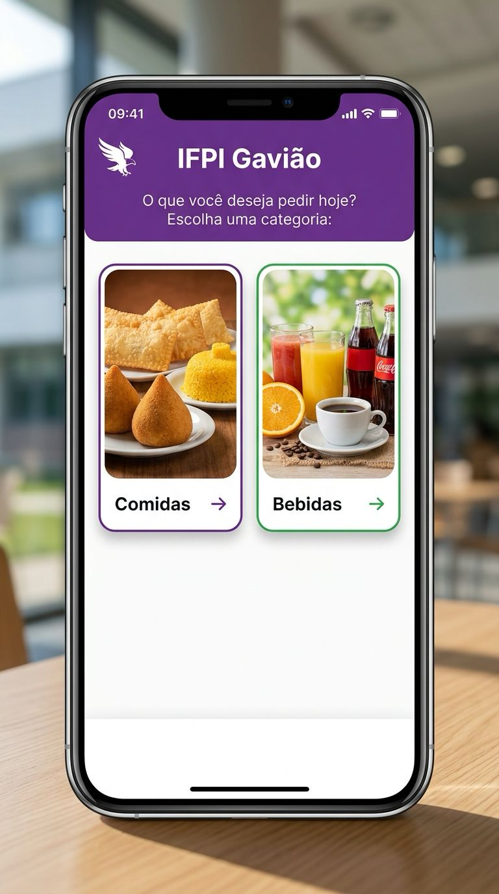

**INSTITUTO FEDERAL DO PIAUÍ - IFPI - `ATIVIDADE PRÁTICA`**  
Tecnologia em Análise e Desenvolvimento de Sistemas (TADS)  
**Disciplina**: Programação para Dispositivos Móveis (PDM) | **Prof.:** Iallen Gábio  

> [!IMPORTANT] # 🦅 Atividade: Evolução para o MVVM Sofisticado  
> Cardápio Digital IFPI Gavião – Da Arquitetura Simplificada para a Sofisticada

### 1. Contextualização e Objetivo

Na atividade anterior, você realizou a refatoração do aplicativo **IFPI Gavião** para o padrão **MVVM Simplificado**.  
Agora, daremos o próximo passo rumo a uma arquitetura profissional, desacoplada e com alto índice de testabilidade: o  
**MVVM Sofisticado**.  

O objetivo desta atividade é pegar a sua base em **MVVM Simplificado** e reestruturá-la de acordo com as diretrizes do  
**Capítulo 10 do livro de PDM** (_"MVVM Sofisticado com React Native, TypeScript e Expo"_), aplicando os princípios de  
**Clean Architecture** e Inversão de Dependências (DIP).  

### 2. O Que Muda em Relação ao MVVM Simplificado?

* **Regras de Negócio em Use Cases:** A ViewModel não contém regras de negócio nem validações de domínio. Toda regra fica isolada em Use Cases na camada `src/usecase/`.
* **Dependência Exclusiva de Abstrações:** Nem a ViewModel nem os Use Cases conhecem implementações concretas; eles interagem apenas com interfaces (prefixadas com `I`).
* **Isolamento da Infraestrutura (`src/infra/`):** O código concreto de acesso aos dados fica restrito à infraestrutura e nunca vaza detalhes ou erros técnicos para cima.
* **Injeção de Dependências (`src/di/container.ts`):** Ponto único de composição que instancia a infraestrutura e a conecta aos Use Cases. As ViewModels recebem seus Use Cases por parâmetro (com default do container), permitindo fácil criação de testes unitários.
* **Tratamento Estruturado de Erros:** Criação de `src/model/errors.ts` com a classe base `DomainError` e erros específicos
(`ValidationError`, `DataSourceError`). A ViewModel trata `err instanceof DomainError` para exibir mensagens ao usuário.

### 3. Passo a Passo para Realização

1. **Utilize a sua base da atividade anterior:**  
Abra o seu repositório do **IFPI Gavião** (já refatorado no padrão MVVM Simplificado) e crie uma nova branch:
```Bash
git checkout -b feature/refactor-mvvm-sofisticado
```

2. **Evolua as Camadas conforme o Capítulo 10:**
   * **Domínio (`src/model/`):** Organize em `entities/` (entidades puras), `datasources/` (interfaces `iProductDataSource.ts`, `iCategoryDataSource.ts`) e `errors.ts`.
   * **Infraestrutura (`src/infra/`):** Implementações com atraso assíncrono em `infra/datasources/`, implementando os contratos do domínio e convertendo erros externos.
   * **Casos de Uso (`src/usecase/`):** Contratos (`iMenuUseCases.ts`) e implementação (`menuUseCases.ts`) com as regras de negócio e validações.
   * **Injeção (`src/di/container.ts`):** Instanciação da infraestrutura e exportação da instância dos Use Cases.
   * **ViewModels (`src/viewmodel/`):** Ajuste dos hooks para dependerem apenas das interfaces de Use Case injetadas via parâmetro.
   * **Views e Rotas:** Mantenha a fidelidade visual das telas em `src/view/` e as rotas finas em `src/app/`.
3. **Teste e envie as alterações:**
```Bash
git push origin feature/refactor-mvvm-sofisticado
```

### 4. Instruções para Entrega

> 📤 Submissão no Google Classroom:  
> Submeta o **link público do seu repositório no GitHub** contendo a branch com a implementação da arquitetura **MVVM Sofisticado**.

### 5. Anexo: Referência Visual das Telas da Aplicação

A aplicação deve manter a mesma funcionalidade, identidade visual e comportamento assíncrono observados nas telas abaixo:

| 1. Tela Inicial (Categorias)     | 2. Listagem de Itens (Cardápio)  | 3. Detalhes do Lanche            |
| :------------------------------: | :------------------------------: | :------------------------------: |
|  |  |  |